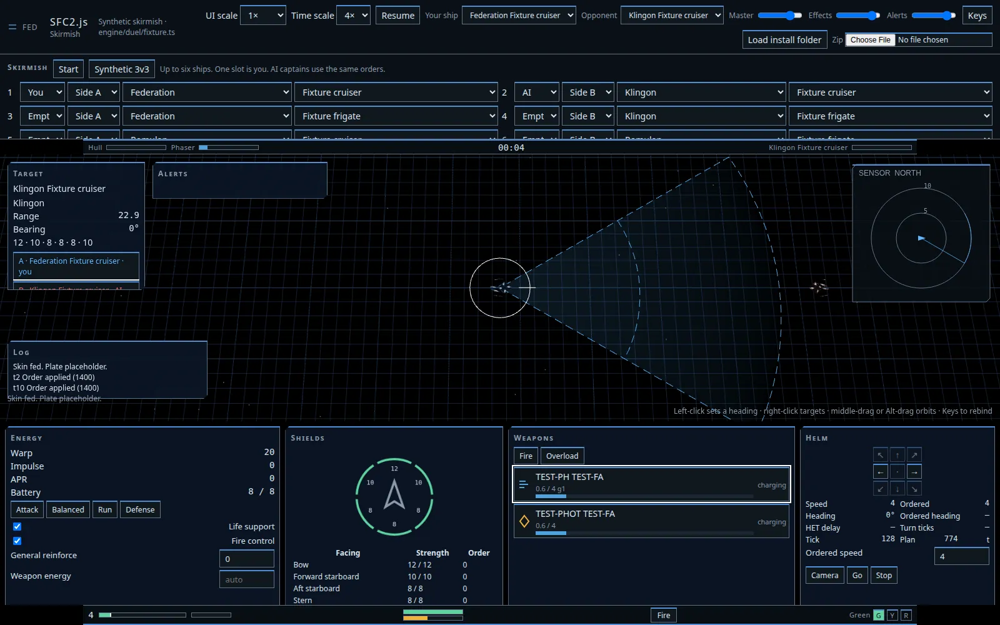
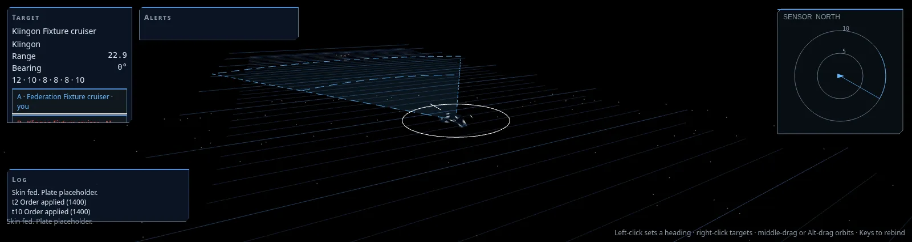
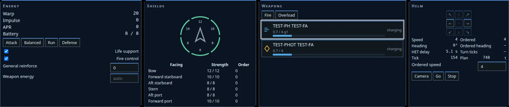
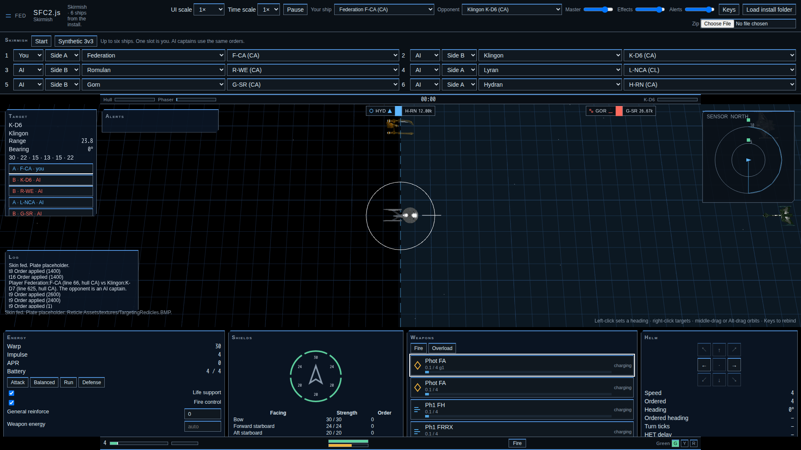
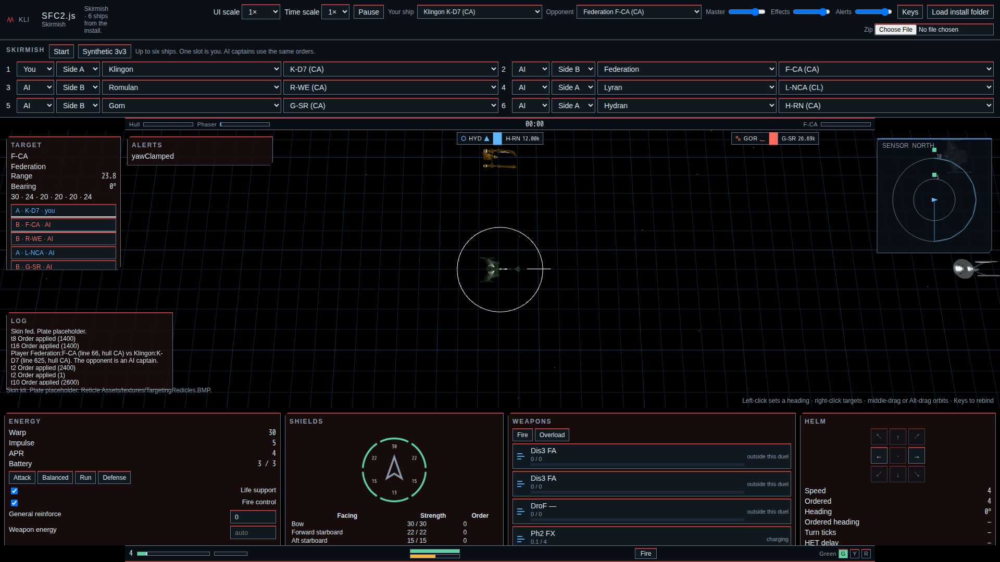

# SFC2.js

SFC2.js is a clean-room engine for *Star Trek: Starfleet Command 2*. It is TypeScript, with a three.js renderer, and it runs in the browser. The reference baseline is Community Edition 2.670. WebAssembly hot paths (AssemblyScript or Rust) are allowed when a path needs them. A Tauri app is the desktop shell. The engine loads the player's own game files and is built to reach skirmish, the empire campaigns, the Conquest map, multiplayer, and mods.

## The kind of game it is

Starfleet Command 2 is real-time tactical combat for one to six starships. You manage a shared power budget and divide it among weapons, shields, engines, and the other systems. Each ship has six shield facings, so the side that is hit matters, and each weapon can fire only inside its own arc, so heading matters too. A normal turn swings the bow over time. A high-energy turn is the fast snap: the ship pauses, spends the power, and comes around to a new heading. You can fight a single skirmish, play through a campaign, or take a ship into multiplayer.

That description is general. It is not the manual, and it is not the game's own marketing.

## Where the work stands

The committed roadmap is [docs/plan.md](docs/plan.md). Current work is **Phase 2** (the tactical duel) and **Phase 3** (the full skirmish). The sim steps at a fixed **30 Hz** on fixed-point integers, so a replay hashes the same state every time. The ship-data audit in `tools/ship-audit` checks shiplist rows for the eight empires named in the plan: Federation, Klingon, Romulan, Lyran, Hydran, Gorn, ISC, and Mirak.

| Status | Phase | Goal |
| --- | --- | --- |
| ✅ Done | 0 Setup | Repository, CI, legal posture, and an inventory of the reference install |
| ✅ Done | 1 Asset pipeline | Parsers, importer, and a ship viewer |
| 🟢 Active | 2 Tactical duel | One ship against one: energy, six shields, arcs, and a deterministic replay |
| 🟢 Active | 3 Full skirmish | The rest of the weapons and systems, fleets, captains, the HUD, and sound |
| ⚪ Planned | 4 Missions | Mission runtime and the first campaign |
| ⚪ Planned | 5 All campaigns | The remaining empire campaigns |
| ⚪ Planned | 6 Conquest | A persistent single-player map |
| ⚪ Planned | 7 Multiplayer | Lockstep battles, a lobby, and a shared server |
| 🟡 Partial | 8 Mods and polish | Mod loading, HD options, a controller, and the Tauri release |

✅ Done · 🟢 Active · 🟡 Partial · ⚪ Planned

Exit criteria, estimates, and the risk register stay in the plan. This table is only the phase list.

## The engine, with placeholder art

These three pictures are the web skirmish on the synthetic fixture in `engine/duel/fixture.ts`. No install was mounted. The dev server answered the install probe with 404. Hulls are the project's placeholder meshes. Plates, marks, and icons are the project's own SVG. `FED` is an original text mark drawn for this UI.



*Tactical overview. The engine with placeholder art and no game data: a Federation fixture cruiser against a Klingon fixture cruiser. The header names `engine/duel/fixture.ts`. The arc, the six shields, and the skirmish board are all the in-repo UI.*



*Close-up. The engine with placeholder art and no game data: the Federation placeholder hull, its forward weapon arc, and the target plate for the Klingon fixture cruiser.*



*Helm. The engine with placeholder art and no game data: power allocation, six shield facings, weapon charge, and a high-energy turn with its delay readout.*

## With your own game files

**The ship models and art in these two images come from the original *Star Trek: Starfleet Command II* game files. That art is not part of this repository or any release, belongs to its rights holders, and players must own a legal copy and point SFC2.js at their own install to see it.**

The pictures are illustrations of that mode. The engine drew them while pointed at a legal install. The models and textures stay on the player's machine. This repository keeps only the two pictures.



*Federation side, hull `F-CA`, in a six-ship skirmish. The ship models and art in this image come from the original game files. They are not part of this repository or any release. Own a legal copy and point SFC2.js at your install to see them.*



*Klingon side, hull `K-D7`, in a six-ship skirmish. The ship models and art in this image come from the original game files. They are not part of this repository or any release. Own a legal copy and point SFC2.js at your install to see them.*

## Run it

The tree expects Node 22.18 or newer and pnpm 10.33.4, the `packageManager` in the root `package.json`.

```sh
pnpm install --frozen-lockfile
pnpm dev:web
```

The tactical page listens on http://127.0.0.1:1701 . With no install path, it boots the synthetic Federation cruiser against the synthetic Klingon cruiser. `pnpm dev:viewer` is the ship catalog on port 4174. `pnpm build:web` writes `web/dist/`. `pnpm test` runs the format parsers, the ship-audit fixtures, and the engine suites.

## Bring your own files

Nothing is uploaded. **Load install folder** uses the browser's directory picker. **Zip** reads an archive you choose. For local development, set `SFC2_INSTALL` to an absolute path, or open the page with `?install=` set to that path. The dev server reads the folder in place under `/__dev/install/` and does not copy it into the repo or into `web/dist`. If a hull has no model file, the view keeps the placeholder mesh. Leave the original files on your machine.

## Desktop builds

`desktop/` is the Tauri v2 shell. The scaffold is `desktop/src-tauri/` ([#124](https://github.com/danielsegan/sfc2.js/pull/124)), with `tauri.conf.json` and the Rust crate. Versioning, tags, and what a release may ship are the Phase 8 process in [docs/release/process.md](docs/release/process.md). The version in the tree today is `0.0.0`. [`.github/workflows/release.yml`](.github/workflows/release.yml) zips the web build on a `v*` tag or a manual run, writes SHA-256 sums, and builds desktop bundles from that Tauri project. Those artifacts are unsigned, and the workflow does not open a GitHub Release. Signing keys remain the owner's decision.

## Contribute

Read [CONTRIBUTING.md](CONTRIBUTING.md) and [docs/LEGAL.md](docs/LEGAL.md) before you open a pull request. Keep changes small and aimed at `main`. Follow the phase you are in, in [docs/plan.md](docs/plan.md). Tests that live in the repo use synthetic fixtures. Real install files stay on the private CI machine. Do not consult the SFC2-decomp project, or any other decompilation of the game, while you work here.

## Legal

This is an unofficial, non-commercial fan project. It is not affiliated with, endorsed by, or connected to Paramount, CBS, Interplay, Taldren, or their successors.

*Star Trek* and *Star Trek: Starfleet Command 2* belong to their respective owners. Players have to own a legal copy. The repository ships no original models, textures, audio, missions, or installers. The code and the notes are a clean-room implementation: written here, and not derived from a decompilation.

The two screenshots under [With your own game files](#with-your-own-game-files) show models and art from the original game. They are approved README illustrations. That art is not a game file in this repository and is not part of any release. On 2026-11-25 the owner decided to publish the repository. The takedown plan for that release is the [takedown policy](docs/LEGAL.md#takedown-policy): a rights holder can write a GitHub issue or contact the owner through the GitHub profile, and on that request we remove those two screenshots and anything else identified, or we take the repository private.

`tools/check-no-game-files.sh` runs in CI on every push and pull request.

## Layout

| Path | Purpose |
| --- | --- |
| `docs/` | Plan, legal notes, format specs, rules, release process, ADRs |
| `engine/` | Simulation core, renderer, mission runtime, AI, audio, netcode |
| `tools/` | Parsers, extractors, inventory scripts, repo checks |
| `web/` | Browser app and HUD |
| `desktop/` | Tauri desktop shell |
| `server/` | Lobby and Conquest server |
| `.github/` | Workflows and GitHub project files |

## License

[GPL-3.0](LICENSE).
