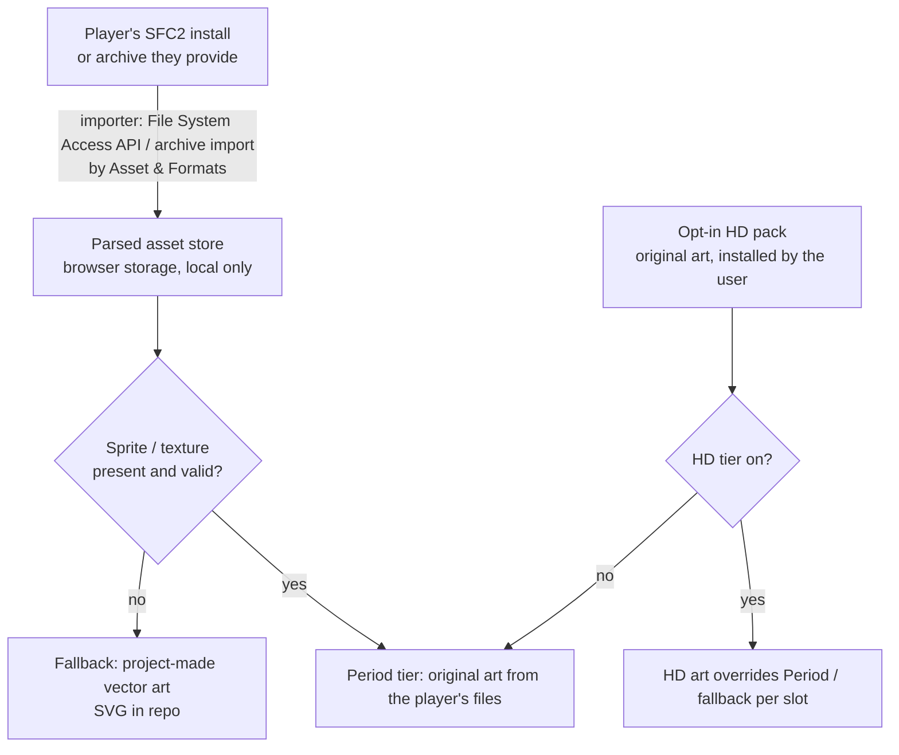

# UI and art asset pipeline

Status: draft v0.1. Baseline: Community Edition (CE) 2.670. Owner: UI & Art Director, with the Asset & Formats Engineer (parsers and importer) and the Engine Lead (renderer). Follows `docs/LEGAL.md`: players bring their own files; nothing original is committed or shipped.

## 1. Sources, in priority order



1. **HD pack**, only if installed **and** the HD tier is on for that feature.
2. **The player's own files**: `sprites.q3` GUI archives and BMPs from their install. This is the default look; we use it wherever possible.
3. **Project fallback**: original vector art committed to the repo. Always present, so the HUD works with zero original assets (useful for CI, tests and a missing or partial install).

Imported originals stay on the player's machine: in browser storage (Origin Private File System / IndexedDB) or read live via a File System Access handle. They are never uploaded, never sent to the multiplayer server, never placed in CI artifacts.

## 2. The HUD sprite slot model

The HUD never names files. It asks for **slots**; a manifest maps slots to sources.

```ts
// Proposed TypeScript (language decided 2026-11-23); field names pending Engine Lead review.
interface SpriteSlot {
  id: string;                 // e.g. "panel.energy.frame", "icon.weapon.photon", "shield.ring.segment"
  size: [number, number];     // logical size on the 1024x768 canvas
  nineSlice?: [number, number, number, number];  // insets for resizable frames
  states?: string[];          // e.g. ["normal","hover","pressed","disabled"]
}
interface SlotBinding {
  slot: string;
  original?: { archive: string; entry: string; rect?: [number, number, number, number]; frame?: number }; // pointer into the player's files
  fallback: string;           // path to our SVG in the repo
  hd?: string;                // path inside an HD pack
}
```

- The **original bindings** (which `sprites.q3` entry and sub-rectangle fills which slot) are data that point into the player's own files. Whether this mapping table may live in the repo is a question for the Producer (it contains file names and coordinates only, no art). Until answered, keep it in a JSON file the importer builds by inspection on the player's machine, plus a reviewed table in `docs/formats/` written from clean-room observation.
- Chrome that the original draws as one bitmap (a whole console background) maps to one slot, and our layout cuts it with nine-slice insets for wide modes. Where a slice would distort the original art, wide mode switches that panel to fallback chrome. **TO VERIFY** per panel against CE 2.670.
- Missing or failing slots fall back **per slot**, not all or nothing. A debug overlay (`?hudDebug=1`) shows each slot's source (original / fallback / HD).

## 2a. Where sprites are drawn (Agreed with Engine Lead, pending docs/engine HUD contract)

- **Tactical HUD:** a dedicated **2D overlay canvas** above the three.js view. Sprites from `sprites.q3`/BMP are uploaded once as `ImageBitmap`s (or packed into atlases) and drawn with `drawImage` at **whole-number scale** (N×, `imageSmoothingEnabled = false`), so they stay pixel-exact. Our SVG fallback and HD art are rasterised to bitmaps at the current N and re-rasterised when N changes.
- **HTML surfaces** (menus, options, briefings, accessibility mirrors) may use the same sprites as CSS backgrounds via object URLs created at runtime from the player's files, with `image-rendering: pixelated` and integer CSS sizes where original art is shown. Nothing is written to disk outside browser storage.
- Per-frame, the HUD reads the read-only `ViewModel` (hud-spec §0). Sprite selection by state (normal / warning / damage / disabled) uses the gauge values of the current tick; flashes come from the frame's one-off events.

## 3. Expected inputs from the Asset & Formats Engineer

| Need | Detail |
| --- | --- |
| `sprites.q3` reader | List entries; decode each to RGBA (`ImageBitmap` or `Uint8ClampedArray` + width and height); expose sub-frames or animation frames if the format has them. Entry naming and palette handling: **TO VERIFY** against CE 2.670, documented in `docs/formats/sprites-q3.md`. |
| BMP decoder | 8-bit palettised and 24-bit, with the colour-key / transparent colour convention the original uses (**TO VERIFY** against CE 2.670: magenta, black, or palette index 0?). Output premultiplied RGBA. |
| Fonts | If the original UI fonts are bitmap sheets, a glyph-metrics reader. Otherwise we use our open fonts (style-guide §3). |
| Inventory | A list of GUI entries with sizes so we can build the slot binding table without screenshots in the repo. |
| Validation | Reports missing or unexpected entries so the HUD can log "using fallback for N slots". |

## 4. Texture and self-illumination conventions for the renderer

What the renderer needs from the importer for ships, bases and terrain (Phase 1 exit: "Every ship in `shiplist.txt` loads and spins with textures and self-illum"):

| Convention | Proposal |
| --- | --- |
| Colour space | Base textures are sRGB; self-illum maps are sRGB on load and converted to linear for emissive. |
| Alpha | Premultiplied after decode. Colour-key pixels become alpha 0. |
| Self-illum pairing | The importer resolves which file is the self-illum map for each base texture (naming rule **TO VERIFY** against CE 2.670, e.g. a suffix) and returns `{ base, selfIllum? }` per material. |
| Self-illum semantics | Black = unlit; brightness = emission strength. Period tier: add unlit on top of the lit base. HD tier: `emissive` × `emissiveIntensity`, bloom threshold tuned so only self-illum areas bloom. |
| UV origin | Normalised to three.js convention (origin bottom-left) in the importer, not in shaders. |
| Mipmaps | Generated at load for 3D textures; never for HUD sprites. |
| Filtering | 3D: trilinear + anisotropic (HD) / bilinear (Period). HUD sprites: always nearest-neighbour at whole-number scale on the 2D overlay canvas (agreed with Engine Lead). |
| Non-power-of-two | Allowed (WebGL2), but the importer reports them. |
| Damage meshes | `_brk` meshes and their materials share the parent's texture set unless the data says otherwise. |
| Hardpoints | Weapon mount positions and facings exported with the model so weapon VFX originate correctly. |
| Compression | Optional runtime transcode to GPU formats is a later optimisation. Caches stay local. |

## 5. Fallback art (original, in-repo)

- Vector only (SVG), drawn by the project in the style guide's language (chamfered plates, our icon grid). Lives under `web/` at a path the Engine Lead picks, with a `LICENSE` note (project license or CC BY-SA, **open question for the Producer**).
- Must be visually distinct from the original: we design from function, not by tracing or redrawing original sprites, and never with an original screenshot as an underlay.
- Ship silhouettes for the shield display: a generic per-size-class hull glyph, not per-ship drawings of canon designs.
- File types (SVG, PNG, KTX2) pass `tools/check-no-game-files.sh`; each file stays under 1 MB.

## 6. HD replacement packs (opt-in, original art only)

- A pack is a folder or zip with `pack.json` (`id`, `version`, `author`, `license`, `targets`: list of slot ids and material ids) plus assets.
- Only **original** work is accepted for any project-hosted or project-linked pack: no upscales of original game art, no AI upscales of it, no franchise logos or trade dress. Packs the player builds for themselves from their own files are their own business, but the project neither ships nor links them.
- Packs override per slot or material. Missing entries fall through to the player's originals, then to the fallback.
- Loading uses the mod loader planned for Phase 8 (plan.md, "Roadmap").

## 7. Testing

- CI renders the HUD with **fallback art only** and compares screenshots of our own art (no original assets in CI, per `docs/LEGAL.md`).
- The private CI VM runs a smoke test with the real install: every slot resolves, with the count of fallbacks reported. Its screenshots stay on that machine.

## Open questions

**Asset & Formats Engineer**
1. `sprites.q3` structure: entry naming, palettes, multi-frame entries, and whether HUD fonts are inside.
2. BMP transparency convention and the self-illum naming rule.
3. Can the importer produce a GUI inventory (entry, size) that we can review without images?

**Engine Lead**
4. Texture cache location (OPFS vs IndexedDB) and eviction; who owns the cache?
5. Where in `web/` do HUD fallback SVGs and the slot manifest live?

**Producer**
6. May the slot-to-original-entry mapping table (names and rectangles, no pixels) be committed?
7. License for the project's own art: GPL-3.0 with the code, or CC BY-SA 4.0?
