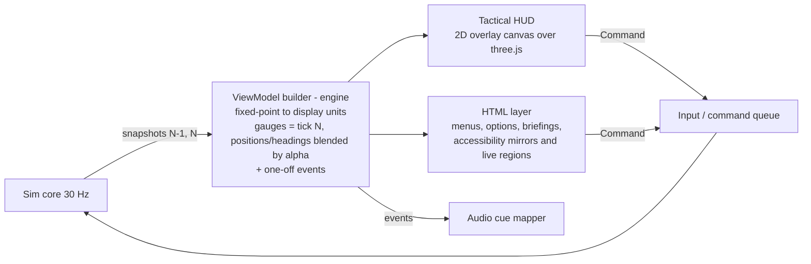

# Tactical HUD spec

Status: draft v0.1. Reference: SFC2's own HUD, baseline Community Edition (CE) 2.670, built from the player's own `sprites.q3` GUI art wherever possible, with original fallback art (see `asset-pipeline.md`). Visual tokens are in `style-guide.md`; scaling, gamepad and accessibility are in `modern-ux.md`.

Scope per plan.md ("Roadmap"): Phase 2 needs components 1–3 and a basic 4, 7 and 12 ("Energy, six shields, arcs, phasers and heavy weapons"). Phase 3 needs the rest ("EW, overloads, boarding, tractors, cloaks, mines, fighters, PFs").

**TO VERIFY** marks behaviour we believe SFC2 has but have not yet checked against CE 2.670 running under Wine. These items are checks, not claims. The Combat Systems Designer's `docs/rules` is the authority on rules. This spec only says how the HUD shows them.

---

## 0. Contract with the engine (PROVISIONAL)

These are the Engine Lead's working answers. They stay **provisional until `docs/engine/determinism.md` lands**.

| Rule | Consequence for the HUD |
| --- | --- |
| The sim runs at a **fixed 30 Hz**; energy and charging are counted in **whole ticks** | Charge bars show ticks, or a fraction of the charge time. Never wall-clock seconds as the source. Seconds are only a derived label (ticks / 30). |
| **Fixed-point math only** in the sim | The HUD converts fixed-point to display units in one place (`hud/units.ts`). Rounding happens only for display. |
| **Distance unit is one swappable constant** | All range labels go through a single `toDisplayRange()` helper. No hard-coded unit names in components. |
| **Headings are uint16**, 65536 per full circle | `deg = h * 360 / 65536`. Arcs and shield facings use the same conversion. |
| Randomness only from **named seeded streams** | The HUD never draws from sim streams. Presentation jitter (debris, flicker) uses its own unseeded RNG. |
| HUD reads a per-frame read-only **`ViewModel`** (see the Agreed section below) | Gauges show the current tick's values; only positions and headings blend (headings along the shortest arc). |
| HUD **never writes into the sim** | All player actions become `Command` objects pushed to the input/command queue. The HUD may show optimistic "pending" state until the next snapshot confirms or rejects. |



### Agreed with Engine Lead (pending docs/engine HUD contract)

Answered by the Engine Lead on 2026-11-23. These hold until the HUD contract in `docs/engine/` lands and supersedes them.

1. **ViewModel per frame.** Each display frame the HUD receives one read-only `ViewModel`, built from the previous and current sim snapshots plus a blend factor `alpha` (0–1). **Gauges are not interpolated**: energy, shields, weapon charge, damage and counts show the *current* tick's values. **Only positions and headings blend.** Each frame also carries a list of **one-off events** (hits, alerts, system damage, and so on) that drive flashes and sound cues.
2. **Rendering surfaces.** The tactical HUD draws on its **own 2D overlay canvas** above the three.js view, so original sprites stay **pixel-exact at whole-number scale steps**. **Menus, options, briefings, and anything text-heavy or accessibility-related are HTML.**

```ts
interface ViewModel {
  tick: Tick; alpha: number;            // alpha applies only to positions and headings
  self: { /* gauge views below (EnergyView, ShieldsView, WeaponView[], ...) at tick N */ };
  contacts: SensorView["contacts"];      // positions and headings already blended
  events: HudEvent[];                    // one-off, this frame only
}
type HudEvent =
  | { kind: "hit"; ship: ShipId; facing: Facing; amount: number }
  | { kind: "alert"; id: string; severity: "info"|"warn"|"crit" }
  | { kind: "systemDamaged"; ship: ShipId; system: string }
  | { kind: string; [k: string]: unknown };   // exact list: Engine Lead
```

Accessibility consequence: components drawn on the canvas aren't in the DOM, so each component's accessibility notes below are delivered by an **HTML mirror** (text tables, live regions, labelled controls) that reads the same `ViewModel`. The canvas itself is `aria-hidden`.

Component field names below are **proposals for the Engine Lead to confirm**; each would be a section of the `ViewModel`. They're written in TypeScript, which Daniel chose as the project language on 2026-11-23, and should become real `.ts` types once confirmed. `Fx` means a fixed-point number; `Tick` means an integer tick count; `Heading16` means a uint16 heading.

Common types:

```ts
type ShipId = number; type Tick = number; type Fx = number; type Heading16 = number;
type Facing = 0|1|2|3|4|5;            // 0 = forward, clockwise; same index as the engine model shields[0..5] (SFB #1..#6 = 0..5); on-screen lettering TO VERIFY
interface Command { kind: string; ship: ShipId; issuedAtTick: Tick; payload: unknown }
```

---

## Layout overview (proposed, our own drawing)

```
+--------------------------------------------------------------------------+
| (4) TARGET INFO          (12b) ALERT BANNER                (6) SENSOR MAP |
| name / class / empire                                      top-down radar |
| range  bearing  shields                                    range rings    |
|                                                                          |
| (12a) MESSAGE LOG                3D VIEW                                  |
|                              (13 camera)                                 |
|                                                                          |
+--------+------------+------------------+----------+---------+-----------+
| (1)    | (2) SHIELD | (3) WEAPONS      | (5)      | (7)     | (8) EW    |
| ENERGY | 6 facings  | groups, arcs,    | DAMAGE   | SPEED   | ECM/ECCM  |
| alloc  | + reinforce| charge/overload  | systems  | HEADING |           |
+--------+------------+------------------+----------+---------+-----------+
| (9) TRACTOR / TRANSPORTER / BOARDING | (10) CLOAK | (11) SHUTTLES/FTR/DRONE/MINES |
+--------------------------------------------------------------------------+
```

How the original arranges its console and which panels are tabs versus always visible: **TO VERIFY**. This layout is a starting point and we expect it to move once checked.

---

## 1. Energy allocation panel

**Purpose.** Show power generated this turn-equivalent versus power spent, and let the player shift power between movement, weapons, shields and systems. This is the core decision surface in SFC2.

**Reads (proposed):**

```ts
interface EnergyView {
  gen: { warp: Fx; impulse: Fx; apr: Fx };          // generation per source, per energy period
  battery: { stored: Fx; capacity: Fx; chargeRate: Fx };
  draws: {
    movement: Fx;              // speed cost
    weapons: Fx;               // sum of weapon charging
    shields: Fx;               // general + specific reinforcement
    systems: Fx;               // life support, fire control, tractors, EW, cloak, transporters, labs...
    perItem: { id: string; label: string; draw: Fx }[];
  };
  available: Fx; surplus: Fx; // surplus < 0 means overdraw
  energyPeriodTicks: Tick;    // TO VERIFY: does SFC2 budget per second, per "turn", or continuously?
  presets: { id: string; label: string }[]; activePreset: string;
}
```

**States.** Balanced (normal); surplus (normal, surplus figure dim); overdraw (warning; the item the sim will starve first is highlighted, and starvation order is **TO VERIFY** with Combat); source damaged (damage hatch on that source); battery draining (charging token, animated down).

**Interactions.**
- Sliders or steppers per draw category; each step is one sim energy unit. Changes send `Command{kind:"setPower", payload:{category, value}}`.
- Presets (for example Attack / Balanced / Run / Defense) send `setPowerPreset`. Whether SFC2 has named presets: **TO VERIFY**.
- Proposed keys: `F1`–`F4` presets, `Shift+F1..F4` save preset, `PgUp/PgDn` on the focused row.

**Accessibility.** The HTML mirror exposes each row as a labelled slider (`role="slider"`, `aria-valuenow` in display units). Overdraw is announced once via the polite live region. Numbers are always shown beside the bars.

**Open/TO VERIFY.** Energy period; whether batteries discharge automatically to cover a shortfall; whether shield reinforcement draws from the same pool.

## 2. Six-facing shield display

**Purpose.** Show strength per facing and reinforcement, and let the player move reinforcement.

**Reads:**

```ts
interface ShieldsView {
  facings: { facing: Facing; current: Fx; max: Fx; damaged: boolean; down: boolean }[]; // 6
  reinforce: { general: Fx; specific: Partial<Record<Facing, Fx>> };
  facingBoundaries16: Heading16[];   // shared with renderer shield VFX
  raised: boolean;                   // shields up/down (TO VERIFY whether toggleable)
  lastHit?: { facing: Facing; atTick: Tick };
}
```

**Drawing.** A ship silhouette (our generic hull glyph; the original's per-ship icon from `sprites.q3` when present) inside a ring of six arc segments. Each segment fills radially by `current/max` and shows a number. Reinforcement is a separate outer band.

**States.** Full (normal); partial (normal fill); under 25% (warning); 0 / down (damage, broken outline); reinforced (outer band, charging token while building up); just hit (150 ms flash triggered by a `hit` event; reduced motion: thicker border).

**Interactions.** Click a facing to send `reinforceFacing` with it; scroll or `+/-` to change the amount; `Shift+click` to clear. Proposed keys: `Num8/9/3/2/1/7` for facings in clock order, `Num5` toggles general reinforcement, `S` toggles shields if allowed.

**Accessibility.** Each facing is a button labelled "Forward-right shield, 14 of 24, reinforced 4". Low and down states use a pattern as well as colour. A text table view in HTML is available (`Alt+S`).

**TO VERIFY.** Facing lettering and order as shown in SFC2; whether specific reinforcement exists per facing in SFC2 or only general; shield regeneration display.

## 3. Weapon status and arcs

**Purpose.** Show each weapon mount's type, charge, overload state, readiness and arc, and allow firing, grouping and arming.

**Reads:**

```ts
interface WeaponView {
  id: string; family: "phaser"|"photon"|"disruptor"|"plasma"|"hellbore"|"fusion"|"drone"|"esg"|"ppd"|"other";
  label: string;                      // e.g. "PH-1 #2" from shiplist designation
  arc: { from16: Heading16; to16: Heading16 }[];   // relative to ship heading; may be several spans
  rangeMax: Fx; rangeBands?: { to: Fx; label: string }[];
  charge: { ticksDone: Tick; ticksNeeded: Tick };  // PROVISIONAL: shown in ticks / fraction
  mode: "normal"|"overload"|"proximity"|"special"; overloadAvailable: boolean;
  status: "ready"|"charging"|"holding"|"firing"|"cooldown"|"damaged"|"destroyed"|"noPower"|"outOfArc"|"outOfRange";
  ammo?: { loaded: number; reloads: number };      // drones, plasma-F etc. TO VERIFY
  group: number;                                   // fire group 1..N
  targetInArc: boolean;
}
```

**Drawing.** A list of weapon chips grouped by fire group. Each chip shows family icon, label, a charge bar (`ticksDone/ticksNeeded`, label "12/30 t" or a fraction, per the provisional contract), and a mode badge. The selected weapon or group draws its arcs on the sensor map (6) and as a ground-plane fan in the 3D view. The `reloadCounted` set is `DroA`, `DroB`, `DroC`, `DroF`, `DroG`, `ADD6` and `ADD12`, matched exactly as in `docs/engine/data-loader.md` (Engine Lead's PR #55). For those racks the Arc cell is a whole-number count and the rack draws no firing arc; the HUD shows the count next to the rack. **TO VERIFY** only whether that count means reloads or rack capacity, and why ADD racks always show 1. Fighter drones `DroI` and `DroVI` keep `ALL` as a normal arc. A numeric Arc on any other weapon, or a letter or empty cell on a `reloadCounted` rack, is the loader's `unknownArc` diagnostic, shown via the `loader.unknownArc` locale key. See `asset-pipeline.md` §3a.

**States.** Ready (normal, single pulse); charging (charging blue, filling); holding a charge (warning outline, and a hold cost line in energy if the rules have one, **TO VERIFY**); overload armed (warning, "OVL" badge); damaged/destroyed (damage, cross-hatch); no power (disabled); out of arc / out of range (disabled tint, dashed arc).

**Interactions.** Click to select; `1`–`6` fire group; `Space` fire selected group at target; `O` toggle overload on selection (sends `setWeaponMode`); `Ctrl+1..6` assign selection to group; `Alt+click` single-fire one mount. Every action sends a `Command`. Optimistic "pending" outline until the snapshot confirms.

**Accessibility.** The HTML mirror lists chips with full text ("Photon 1, charging, 18 of 60 ticks, overload armed, in arc"). Arc fans have a high-contrast outline mode.

**TO VERIFY.** Per-family charge times and whether SFC2 lets players hold charges; plasma bolt versus torpedo modes; proximity fuse for photons; how SFC2 groups weapons by default.

## 4. Target info panel

**Purpose.** Identify the current target and its tactical state.

**Reads:**

```ts
interface TargetView {
  id: ShipId; name: string; className: string; empire: string; hostility: "friendly"|"hostile"|"neutral"|"unknown";
  range: Fx; bearing16: Heading16; relBearing16: Heading16; facingTowardUs: Facing;
  shields?: { facing: Facing; pct: number }[];      // visibility depends on sensors/EW — TO VERIFY
  speed?: Fx; systemsKnown?: { id: string; state: string }[];
  scanQuality: "none"|"partial"|"full";
}
```

**Drawing.** Header with name, class and empire glyph; range and bearing; a small six-facing ring for the target's shields, with the facing exposed to us highlighted; known damage list.

**States.** No target (empty, prompt "Tab to target"); partial info (masked fields "??"); lost (warning, 1 s, then clears).

**Interactions.** `Tab` / `Shift+Tab` next/previous hostile; `T` nearest hostile; `Y` cycle friendlies; click a contact in 3D or on the sensor map. Sends `setTarget`.

**Accessibility.** Target changes are announced (polite). All fields have text equivalents.

**TO VERIFY.** How much target info SFC2 shows before a scan versus after; whether the targeted shield facing is shown.

## 5. Damage readout

**Purpose.** Show internal damage by system, as boxes remaining, and repair progress.

**Reads:**

```ts
interface DamageView {
  systems: { id: string; label: string; boxesTotal: number; boxesLeft: number; repairing: boolean; repairTicksLeft?: Tick }[];
  hull: { boxesTotal: number; boxesLeft: number };
  crew: { current: number; max: number; marines: number };
  repairQueue: string[]; repairPoints?: Fx;           // damage control — TO VERIFY
}
```

**Drawing.** Compact grid of system rows, each with box pips (filled = intact). Hull and crew at the top. Repair queue with drag-to-reorder.

**States.** Intact; damaged (warning when under 50% remain); destroyed (damage); repairing (charging, progress in ticks).

**Interactions.** Drag or `Ctrl+Up/Down` reorders repair priority (sends `setRepairPriority`). `D` toggles expanded view.

**Accessibility.** HTML mirror with table semantics; each row reads "Warp engine, 8 of 15 boxes, repairing".

**TO VERIFY.** SFC2's damage-control model (repair rate, which systems can be repaired in combat) — owned by Combat.

## 6. Tactical / sensor map

**Purpose.** A top-down 2D picture of the battle: contacts, seeking weapons, terrain, weapon arcs and range rings.

**Reads:**

```ts
interface SensorView {
  self: { pos: [Fx, Fx]; heading16: Heading16 };
  contacts: { id: number; kind: "ship"|"base"|"planet"|"asteroid"|"seeking"|"mine"|"shuttle"|"fighter"|"pf";
              pos: [Fx, Fx]; heading16?: Heading16; hostility: string; detected: boolean; cloaked?: boolean }[];
  sensorRange: Fx; mapExtent: Fx;
}
```

**Drawing.** Drawn on the HUD overlay canvas. North-up or heading-up (toggle). Range rings at labelled distances (via `toDisplayRange`). Contacts use our own shape glyphs: ship = chevron, base = square, seeking weapon = small diamond with a velocity tick, mine = dot with a ring once detected. Hostility uses both colour and shape fill (hollow for hostile, solid for friendly).

**States.** Contacts can be detected, lost (fading ghost of their last known position for N ticks), cloaked (owner sees a ghost; enemies see nothing, or a sensor "echo" if the rules allow it, **TO VERIFY**).

**Interactions.** Wheel to zoom; click to target; `M` toggles the full-screen map; `H` toggles north-up versus heading-up.

**Accessibility.** "List contacts" mode (`Alt+M`) gives a sortable text table of range, bearing and type.

## 7. Speed and heading

**Purpose.** Current and ordered speed, heading, turn-mode constraints.

**Reads:**

```ts
interface HelmView {
  speed: Fx; speedOrdered: Fx; speedMax: Fx; speedMaxForPower: Fx;
  heading16: Heading16; headingOrdered16?: Heading16; turnRateLimit16PerTick?: number;  // turn mode — TO VERIFY form
  reverse: boolean; erraticManeuvers?: boolean; highEnergyTurnAvailable?: boolean;      // TO VERIFY in SFC2
}
```

**Drawing.** Vertical speed tape with the ordered speed caret and a "max for current power" marker; compass rose with current and ordered heading, with an arc showing what can be reached within the turn limit.

**Interactions.** `W/S` or `+/-` raises or lowers ordered speed; `A/D` turn left or right; `X` all stop; `R` reverse; click the compass to set ordered heading; `E` erratic maneuvers if supported. All of these send `setSpeed` / `setHeading` / `helmToggle`.

**Accessibility.** Numbers are always visible; announced on change only when the player requests it (no spam).

**TO VERIFY.** How SFC2 exposes turn modes to the player; whether reverse and emergency deceleration exist as commands.

## 8. EW / ECM / ECCM

**Purpose.** Show and set electronic-warfare power and the net EW shift against the target.

**Reads:**

```ts
interface EwView {
  ecm: Fx; eccm: Fx; ecmMax: Fx; eccmMax: Fx; sensorsDamaged: boolean;
  netShiftVsTarget?: number;           // signed; shown as hit-chance modifier label — TO VERIFY form
  sources: { label: string; value: Fx }[];   // ship, scouts, terrain, etc.
}
```

**Drawing.** Two short bars (ECM, ECCM) plus a net-shift badge: green advantage, amber neutral, red disadvantage, and always a signed number too.

**Interactions.** `[` `]` shift points between ECM and ECCM; `Ctrl+[` / `Ctrl+]` change the total EW draw. Sends `setEw`.

**TO VERIFY.** How SFC2 presents EW (allocation vs auto) and whether net shift is visible to the player at all.

## 9. Tractor, transporter and boarding controls

**Purpose.** Tractor and repel; transporter actions (hit-and-run raids, boarding parties, mines dropping via transporter if supported); boarding status.

**Reads:**

```ts
interface TacticalOpsView {
  tractor: { state: "idle"|"engaging"|"holding"|"repelling"|"broken"; targetId?: ShipId; strength?: Fx; inRange: boolean };
  transporter: { ready: boolean; rechargeTicksLeft: Tick; range: Fx; targetShieldDownFacing: boolean;
                 marines: number; hitAndRunTargets: { id: string; label: string }[] };
  boarding: { attackersAboard: number; defenders: number; progress?: number }[];  // per ship involved
}
```

**Drawing.** Three sub-panels in one strip. Transporter shows marine count and a "requires a down shield facing toward target" hint when blocked (rule **TO VERIFY** with Combat).

**Interactions.** `G` tractor target; `Shift+G` repel/release; `B` send boarding party; `Shift+B` choose a hit-and-run system target (opens a picker of the target's known systems). Sends `tractor`, `transport`, `hitAndRun`.

**States.** Unavailable (disabled with reason tooltip: out of range / shields up / no marines / recharging); armed; in progress; result (log message).

**Accessibility.** Disabled buttons expose their reason as text, not only via tooltip.

## 10. Cloak

**Purpose.** Cloak status and control for ships that have one.

**Reads:** `{ fitted: boolean; state: "off"|"engaging"|"on"|"disengaging"; ticksLeft: Tick; costPerPeriod: Fx; weaponsLocked: boolean }`.

**Drawing.** Single toggle with a progress ring while engaging or disengaging; "weapons locked while cloaked" note when applicable (**TO VERIFY** with Combat).

**Interactions.** `C` toggles (sends `cloak`). Hidden when not fitted.

## 11. Shuttles, fighters, PFs, drones and mines

**Purpose.** Launch and manage carried craft and seeking weapons, and lay mines.

**Reads:**

```ts
interface CraftView {
  bays: { kind: "shuttle"|"fighter"|"pf"; type: string; ready: number; total: number; launchCooldownTicks: Tick }[];
  launched: { id: number; kind: string; type: string; order: "attack"|"defend"|"return"|"wildWeasel"|"suicide"|string; targetId?: ShipId }[];
  drones: { rack: string; loaded: number; reloads: number; reloadTicksLeft: Tick; speed: Fx; type: string }[];
  mines: { type: string; count: number; canLay: boolean }[];   // T-bomb / NSM etc. — TO VERIFY names in shiplist data
}
```

**Interactions.** `L` launch selected bay; `Shift+L` recall all; `K` drop mine (sends `layMine`); `J` launch drone at target; order buttons per flight (attack/defend/return). Specialist shuttle orders (for example wild weasel, suicide shuttle) are shown only if the rules include them (**TO VERIFY**).

**Accessibility.** Counts in text; flights listed as a table.

## 12. Message log and alerts

**12a Message log.** Scrolling list, newest last, max 200 lines in memory, filters (combat / comms / system / mission). Reads `{ tick: Tick; channel: string; text: string; severity: "info"|"warn"|"crit"; fromShip?: ShipId }[]`. Mission text comes from the Mission runtime. Original strings come from the player's install; nothing is copied into the repo. `Enter` focuses chat in multiplayer; `PgUp/PgDn` scroll.

**12b Alerts.** A banner region for high-priority events: incoming seeking weapon, shield facing down, boarding, hull critical, self-destruct countdown, mission objective. At most two at a time; the rest queue. Alerts come from `alert` events in the `ViewModel`; each raises a sound hook (style-guide §7). Screen-reader: assertive live region for `crit`, polite otherwise.

## 13. Camera controls

**Purpose.** Look around the 3D view without affecting the sim.

**Modes.** Chase (behind own ship), orbit (free around own ship), target lock (keeps own ship and target in frame), tactical overhead, free fly (spectator/replay).

**Interactions.** Right-drag orbit; wheel zoom; `V` cycle mode; `Home` reset; `Ctrl+V` target lock. Camera shake is off with reduced motion. Camera state is purely client-side.

**TO VERIFY.** Which camera modes SFC2 offers and their default keys.

## 14. Mission surfaces and rule feedback

These are the HUD parts that answer to the Mission API (`docs/missions`, merged in #1) and the rules module. Event names follow that doc. Placement is our own proposal, and SFC2's own placement is **TO VERIFY** against CE 2.670 (#37).

**14a Briefing, debrief and hail panels (HTML).** These are three HTML components, drawn above the overlay canvas and fully reachable by keyboard and screen readers. Each one is driven by a `briefing`, `debrief` or `hail` event that carries a string key. It can also carry optional `speakerKey` and `portraitKey` fields (Mission API, #43). Both stay optional, so when a mission leaves one out the panel shows no speaker name or uses the fallback silhouette below. The text is looked up through the locale layer (14d). The portrait comes from the player's install through the asset pipeline (`asset-pipeline.md`). Where there is none, an original silhouette is used instead. A briefing pauses single-player play until it is dismissed. A hail never pauses: it docks beside the message log and times out into it. Debrief shows results from the mission runtime and never calculates its own score.

**14b Objectives list (HTML).** This is a collapsible list with three states, active, complete and failed, and each state has both a colour and an icon (never colour alone). On `objectiveUpdated`, the list expands for about 4 s (120 ticks), highlights the changed row, then collapses again. Reduced-motion users get no animation, and the row is simply marked. Every change is also written to the message log (§12a) so that screen readers announce it.

**14c Mission timer (overlay canvas).** `missionTimer` events drive a countdown near the message log. It counts in ticks and is shown as `mm:ss`, using 30 ticks per second. Only one timer is pinned at a time; if more are running, the one ending soonest is shown, and the others are listed in the objectives panel. During the last 10 s the timer pulses (a steady colour change when reduced motion is on) and raises a sound hook. Starting, pausing and expiring are also written to the message log.

**14d Locale and strings.** English is the only locale at launch. Lookups fall back to English when a key is missing, and a key with no English string shows the raw key in a debug style, never a blank. The original game's strings are read from the player's own string tables at runtime and never committed. Our own strings live in the repo keyed the same way. Diagnostics and rule reasons arrive as `{ code, source, ... }`, and their locale key is `source.code`, for example `rules.noSuchSystem`, `loader.unknownWeapon` or `shiplist.duplicateClassKey`. Codes are unique only within a source, so the source prefix keeps keys from clashing. The full list of codes will live in the engine diagnostics registry (`docs/engine/diagnostics.md`, being written by the Engine Lead).

**14e Rule results.** Script and combat changes come back as `ruleResult { token, status: applied | clamped | rejected, reason, appliedValue }`. When the status is `applied`, nothing visible happens. When it is `clamped`, the affected gauge flashes once in the warn colour and shows the clamped `appliedValue`, and the reason is posted to the message log as a keyed `warn` line. When it is `rejected`, the control's pending state is cleared, the gauge flashes in the crit colour, and the reason is posted as a `warn` line. The `reason` string is the stable camelCase code from the registry in `docs/rules`, and we look it up as the locale key `rules.<reason>` (14d). The HUD never writes into the sim; it only reports what the rules decided.

**14f Spawned and placed objects.** `spawned { token, entityId }` and `placed { token, objectId }` events (both in `docs/missions/mission-api.md`) add the new entity to the sensor map (§6) and the target cycle (§4) on the tick they arrive. Ships and map objects share one id allocator, so the HUD keys everything by the shared id (`entityId` or `objectId`). A newly spawned hostile raises an alert (§12b) only if the mission marks it as one.

---

## Proposed default keymap (summary)

All keys are **proposals**. SFC2's original defaults are **TO VERIFY** against CE 2.670, and we may offer a "classic" profile that matches them. Everything is rebindable (`modern-ux.md`).

| Area | Keys |
| --- | --- |
| Helm | `W/S` speed, `A/D` turn, `X` stop, `R` reverse, `E` erratic |
| Weapons | `1–6` fire group, `Space` fire selected, `O` overload, `Ctrl+1–6` assign group |
| Shields | `Num8/9/3/2/1/7` reinforce facing, `Num5` general |
| Power | `F1–F4` presets |
| Targeting | `Tab`, `Shift+Tab`, `T`, `Y` |
| Ops | `G`/`Shift+G` tractor, `B`/`Shift+B` board / hit-and-run, `C` cloak |
| Craft | `L`/`Shift+L` launch/recall, `J` drone, `K` mine |
| EW | `[` `]`, `Ctrl+[` `Ctrl+]` |
| View | `V` camera, `M` map, `H` map orientation, `Home` reset, `Esc` menu / pause (single player only) |

## Open questions

**Engine Lead**
(Snapshot delivery and the HUD rendering surface are settled; see §0, "Agreed with Engine Lead".)

1. The exact `HudEvent` list and payloads.
2. Confirm the `Command` envelope. Rejected script and combat changes come back as `ruleResult` (§14e). Do plain player commands use the same path?
3. Where does the fixed-point → display conversion live: shared `engine/units` or HUD-only?
4. Will the provisional 30 Hz, uint16 heading and fixed-point rules be final in `docs/engine/determinism.md`?

**Combat Systems Designer**
5. Energy period and starvation order on overdraw.
6. Per-facing specific reinforcement: present in SFC2 or general-only?
7. Which target details are visible without a scan; is net EW shift player-visible?
8. Transporter and hit-and-run preconditions (down shield facing, range) and the hit-and-run target list.
9. Weapon hold-charge rules and overload range limits the HUD should warn about.

**Asset & Formats Engineer**
10. Do per-ship HUD icons and silhouettes exist in `sprites.q3`, and how are they keyed to shiplist entries?

**Daniel**
11. Default keymap: our modern proposal, or the SFC2 originals as the default?
